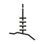

# Entur public transport for Home Assistant

Departures from Entur, set up in the user interface instead of YAML. Stops are found by name, and lines and directions are picked from lists.

Status: 0.6.0 — 2026-11-13 07:15

## Installation

1. In Marketplace, open the menu and choose Custom repositories.
2. Add `https://github.com/0z00z0/ha-entur-public-transport` with the type Integration.
3. Download Entur public transport and restart Home Assistant.
4. Add Entur under Settings, Devices & services.

Updates come through Marketplace. On Home Assistant before 2026.11, HACS works the same way.

The domain is `entur_public_transport`, so this replaces the built-in integration while it is installed. Removing it from `custom_components` brings the built-in one back. Requires Home Assistant 2026.10.0 or newer.

A YAML setup of the built-in sensor is imported on start, one entry per stop place, with platforms joined to their stop. The imported sensors keep the entity ids and names the built-in integration gave them, such as `sensor.entur_nordby_stasjon` and `sensor.entur_nordby_stasjon_platform_1`. A repair notice then asks for the YAML to be removed.

## Setup

1. Search for a stop by name, for example Jernbanetorget.
2. Pick the stop from the matches.
3. Choose lines, platforms, number of departures, whether to hide departures without boarding, whether to add every platform, and whether to show the position on the map.

Each line is listed once per direction, with the destinations shown on the vehicle, for example `31 → Fornebu / Snarøya`. Picking one direction hides departures the other way; picking both, or none, shows everything.

Each stop is one entry. The settings can be changed later under Configure, and the entry reloads on save.

## Sensors

- One sensor for the stop, and one per chosen platform. The state is minutes to the next departure.
- One sensor per chosen line and direction, for example `sensor.nordby_stasjon_r13_dal_eidsvoll` and `sensor.nordby_stasjon_r13_drammen_kongsberg`. A line chosen without a direction gets one sensor per direction it runs. The state and attributes are the same as for the stop sensor, limited to that line and direction.
- The unique id of a line sensor is the stop id, line id and direction key, so a changed destination text does not change the entity.
- A sensor is removed only when its line, direction or platform is deselected, or when adding every platform is turned off. A direction or platform without departures keeps its sensor, which then shows none.
- A line chosen as a whole keeps a sensor for every direction it has had. Choosing some of its directions instead removes the others; directions that have a sensor stay on offer in the form.
- The whole-line choice in the form is labelled in the server language, for example `R13 (both directions)`.
- With adding every platform on, the platforms it added stay until it is turned off.
- On a ring line that shows the same destination in both directions, the less frequent direction can show fewer departures than configured.

## Attributes

The attributes of the built-in YAML sensor keep their names, types and meaning, and are set when there is a departure to fill them:

| Attribute | Value |
|---|---|
| `route`, `route_id` | Next departure: line and destination, `R13 Drammen`, and Entur line id |
| `due_at` | Expected time of the next departure, `HH:MM` |
| `delay` | Delay of the next departure in whole minutes |
| `real_time` | `true` when the next departure has real-time data |
| `next_route`, `next_route_id`, `next_due_at`, `next_delay`, `next_real_time` | The same for the departure after |
| `next_due_in` | Minutes to the departure after, as text, `44 min` |
| `departure_#3` … | Later departures as text, `06:33 R13 Drammen`, prefixed `ca. ` without real-time data |

Every departure slot n from 1 to the configured number of departures is always present:

| Attribute | Value |
|---|---|
| `departure_<n>_route` | Line and destination, `R13 Drammen` |
| `departure_<n>_route_id` | Entur line id, `VYG:Line:R13` |
| `departure_<n>_aimed` | Timetabled departure, local ISO 8601, `2026-11-07T20:03:00+01:00` |
| `departure_<n>_expected` | Expected departure, same format |
| `departure_<n>_delay` | Minutes the expected time is later than the aimed time, truncated toward zero: 59 s is 0, 60–119 s is 1, and up to 59 s early is 0 |
| `departure_<n>_realtime` | `true` when Entur has real-time data for the departure |
| `departures` | All departures as one JSON string, keys `r`, `id`, `a`, `e`, `d`, `rt` matching the rows above |
| `stop_id`, `attribution` | Entur id of the stop or platform, and the data licence |

- A missing value is `null`, never estimated. An empty slot has every field `null` and is left out of `departures`.
- Without real-time data, `realtime` is false and `expected` equals `aimed`.
- `departures` is a string because Home Assistant sends list and dict attributes to ESPHome as Python text, not JSON. Eight departures take about 950 characters.
- The `departure_<n>_…` attributes and `departures` are not recorded in history.

## Disruptions

Each stop also gets a Disruptions sensor, named Avvik in Norwegian. The state is the number of cancelled and cut-short departures. A cut-short departure runs from the stop but is cancelled before the end of its trip.

- `affected_departures` lists them with `line`, `direction`, `destination`, `aimed`, `expected`, `status` and `last_stop`. `status` is `cancelled` or `cut_short`; `last_stop` is the last stop the trip serves, and empty for a cancelled departure. A trip that ends at the stop itself has that stop as `last_stop`.
- `situations` lists Entur's messages for the trips with `summary`, `lines` and `ids`.
- `disruptions` holds the same as one JSON string.
- The unique id is the stop id with `_disruptions`.

The action `entur_public_transport.get_situation` returns the full text of one message. Pass one of the `ids` as `situation_id`; the response has `id`, `summary` and `description`.

```yaml
action: entur_public_transport.get_situation
data:
  situation_id: "NSB:SituationNumber:1692a463-3cc6-42fe-a59d-a5f2a5c2adc6"
response_variable: message
```

## Covered operators

Entur has timetables and real-time data from the authorities and operators below, taken from Entur's own register without duplicates and entries that are not transport providers.

### Authorities (69)

| Logo | Name |
|---|---|
|  | Agder Kollektivtrafikk AS |
|  | Alpinco |
|  | Askeladden Reiser |
|  | AtB |
|  | Avinor |
|  | Blindleia Charter |
|  | Brakar |
|  | Bussring |
|  | Bygdøyfergen |
|  | Farte |
|  | Fjord Line |
|  | Fjord X |
|  | Fjord1 ASA |
|  | FlixBus |
|  | Flybussen Connect |
|  | Flytoget |
|  | Flåm Travel |
|  | FRAM |
|  | Fredrikstad kommune |
|  | Geiranger Fjordservice |
|  | Go-Ahead Norge AS |
|  | Havila |
|  | Hurtigruten |
|  | Hyke |
|  | Innlandstrafikk |
|  | Jotunheimen og Valdresruten Bilselskap |
|  | Kolumbus |
|  | Lustrabaatane |
|  | NOR-WAY Bussekspress |
|  | Nordland fylkeskommune |
|  | Norled AS |
|  | Norrtåg |
|  | Ruter |
|  | SJ |
|  | SJ Nord |
|  | Skyss |
|  | Snelandia |
|  | Snälltåget |
|  | Sundbåten |
|  | Svipper |
|  | Tide AS |
|  | Torghatten |
|  | Torghatten Sør |
|  | Ulriken |
|  | Unibuss |
|  | Vestlandske |
|  | VKT |
|  | Vy |
|  | VY Bus4You |
|  | Vy Tåg |
|  | Västtrafik AB |
|  | Öresundståg |
|  | Østfold kollektivtrafikk |

Also covered: AMBU Pendlerrute, Beffen, Best Arctic Group, Boreal Norge, Fjonesundet, Fjord Tours, Forsvarsbygg Oscarsborgfergen, Go Fjords, Høgsfjordferja, MF Øisang, Norway's best, Rada Reiseliv, The Fjords, Voss Gondol, Vy Buss, Ålesund Turvogn Service.

### Operators (30)

Operators that run services for the authorities above, or on their own account.

| Logo | Name |
|---|---|
|  | Go-Ahead Nordic |
|  | Nobina |
|  | Connect Bus |
|  | Sporveien T-banen |
|  | Sporveien Trikken |
|  | Widerøe |
|  | SJ |
|  | SJ Nord |
|  | Tide |
|  | Nordlandsbuss |
|  | Rødne Trafikk |
|  | Firda Billag |
|  | Flåmsbanen |
|  | Torp Ekspressen |
|  | Flybussen Bergen |
|  | Flybussen Stavanger |
|  | Veøy Buss |
|  | Lovundskyss |

Also covered: Norwegian, SAS, Boreal, Bastø Fosen, Vidar Hop, Gråkallbanen, Bybanen, Fjord Shuttle, Haukeliekspressen, Hvalerferga, Skilsøferga, Rutebåten Utsira.

Logos are trademarks of their respective owners and are shown only to identify the services covered.

## Licence

Apache-2.0, as Home Assistant core, from which the integration is derived. Data is provided by entur.org under NLOD.
